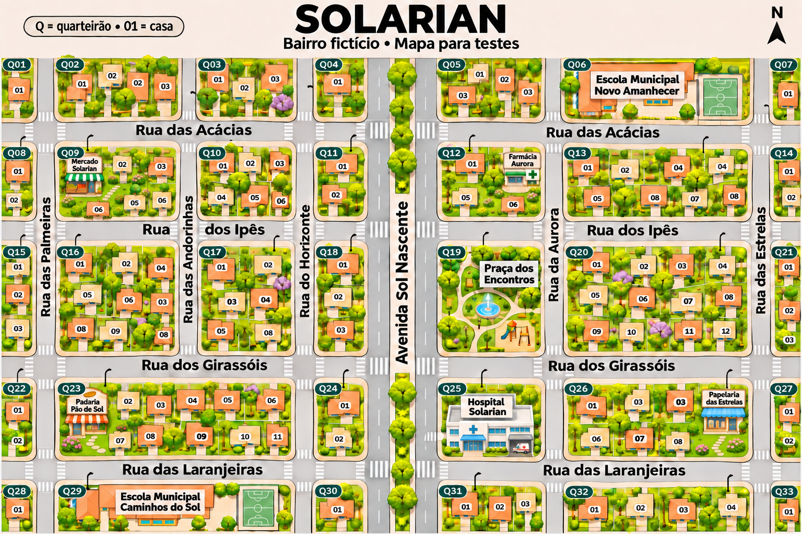

# Bairro Solarian: Neighborhood Action Dashboard

**FIAP ON | Ciência da Computação | Global Solution 2026.2 | CitizenTech**

O Bairro Solarian é uma simulação realista de um sistema de gestão comunitária. O projeto parte de situações do cotidiano de um bairro, como a lâmpada apagada, a calçada sem acesso e o lixo acumulado, e reproduz funcionalidades presentes em serviços reais de atendimento ao cidadão: registro de ocorrências, triagem, acompanhamento de cada etapa, apoio a registros existentes, indicadores e agenda de eventos.

O objetivo é compreender a rotina dos moradores e demonstrar como a organização das informações facilita a vida em comunidade, aproximando quem relata um problema de quem administra o bairro e tornando visível o andamento de cada solicitação.



## 1. Equipe Tribo Solarian

| Integrante | RM |
|---|---|
| Cláudio Roberto Grillo Reis Silveira | RM575353 |
| Vitor Lima Montiel | RM575458 |
| Wallace Gabriel Américo Albuquerque | RM575435 |
| Victor Augusto dos Santos Souza | RM576021 |
| Thales Martins Oliveira Barros | RM574664 |

## 2. Bairro simulado, problema e público beneficiado

**O bairro.** Solarian é um bairro fictício com 33 quarteirões, dez vias e oito pontos de referência, entre eles a Praça dos Encontros, duas escolas municipais, o Hospital Solarian e quatro estabelecimentos comerciais. A Avenida Sol Nascente divide o bairro em dois lados, Oeste e Leste. O cadastro reúne 28 moradores fictícios, e a convivência é orientada por 17 regras próprias. A descrição completa está em [docs/bairro-solarian.md](docs/bairro-solarian.md).

**O problema.** Em um bairro, os relatos sobre iluminação, acessibilidade, limpeza e conservação costumam ficar dispersos. As prioridades não ficam claras e o morador não consegue acompanhar o que aconteceu com a solicitação que fez.

**A solução.** O sistema concentra os registros em um único painel, classifica cada ocorrência, mostra em que situação ela se encontra, preserva o histórico de alterações e resume o conjunto em indicadores.

**Público beneficiado.** Os moradores, que registram e acompanham ocorrências e consultam a agenda e as regras do bairro, e o gestor do bairro, que examina os registros, atualiza as situações e acompanha os indicadores.

## 3. Estruturas de dados e justificativas

| Estrutura | Onde é utilizada | Justificativa |
|---|---|---|
| Lista | `banco["ocorrencias"]` | Guarda o conjunto completo de ocorrências, percorrido nas listagens, nos filtros e nos indicadores. |
| Dicionário | `estado["indice"]` | Associa o código à ocorrência e permite localizar um registro diretamente, sem percorrer a lista. |
| Fila | `banco["fila_triagem"]` | Organiza as ocorrências abertas ainda não examinadas. A que foi registrada primeiro é examinada primeiro, o que garante atendimento por ordem de chegada. |
| Pilha | `estado["pilha"]` | Guarda as atualizações de situação. A mais recente fica no topo, o que permite consultar os eventos recentes e desfazer a última alteração. |
| Hierarquia | `estado["hierarquia"]` | Dicionários aninhados no formato bairro, lado, categoria e códigos das ocorrências. Mostra onde cada tipo de problema se concentra. |
| Matriz | `estado["matriz"]` | Lista de listas em que cada linha é uma categoria e cada coluna é uma situação. É a base dos totais e das proporções do painel. |

**Algoritmos.** A ordenação por inserção, escrita pela equipe, organiza as pendências da mais antiga para a mais recente, da mais apoiada para a menos apoiada, e a agenda por data. A busca sequencial com condições combinadas atende aos filtros. A consulta por código utiliza o dicionário. A busca binária sobre a lista ordenada por código foi implementada para comparação e é verificada nas conferências do sistema, nas quais devolve o mesmo resultado que o dicionário.

**Dados e persistência.** As ocorrências iniciais, o bairro e os moradores são inicializados no próprio código, opção prevista no enunciado. O arquivo `dados/banco.json` guarda apenas o estado alterado durante o uso: dia simulado, ocorrências, histórico, fila de triagem, registros rejeitados e agenda. O formato JSON foi adotado porque representa diretamente listas e dicionários e é lido e gravado pela biblioteca padrão do Python.

**Dados simulados.** A base inicial contém 12 ocorrências, três em cada categoria, 17 atualizações de histórico e três registros com defeitos propositais: categoria ausente, situação desconhecida e código repetido. A validação identifica esses registros na carga e os separa na tela *Registros com problema*.

## 4. Regras lógicas

**Cadastro.** O morador escolhe por número a categoria, o lado do bairro e o local. Apenas a descrição é digitada. O registro só é aceito se todos os campos obrigatórios estiverem preenchidos, se a categoria for uma das quatro padronizadas e se o local pertencer ao lado informado.

**Validação.** A função `validar_registro` devolve a lista de inconsistências de um registro. Lista vazia indica registro válido. A mesma função é aplicada na carga inicial e no cadastro pelo terminal.

**Duplicidade.** Antes do cadastro, o sistema procura uma ocorrência pendente de mesma categoria no mesmo local. Se existir, orienta o morador a apoiar o registro existente, conforme a regra 15 do bairro.

**Consulta.** A busca por código utiliza o dicionário. Os filtros por categoria, situação, lado do bairro, pendências e atrasos percorrem a lista e mantêm apenas os registros que atendem a todos os critérios informados.

**Atualização de situação.** Cada situação admite apenas as seguintes definidas na tabela de transições:

| Situação | Significado | Próximas permitidas |
|---|---|---|
| Aberta | Registrada pelo morador e ainda não examinada pelo gestor | Em análise |
| Em análise | Examinada pelo gestor, que avalia se pode ser atendida | Em atendimento ou Recusada |
| Em atendimento | Aceita, com o serviço em andamento | Concluída |
| Concluída | Serviço finalizado | Nenhuma |
| Recusada | Encerrada sem atendimento, com o motivo registrado | Nenhuma |

**Expressão booleana documentada.** A atualização de situação só é realizada quando a expressão abaixo é verdadeira:

```python
pode_atualizar = perfil_gestor and id_existe and situacao_conhecida and transicao_valida
```

Cada termo corresponde a uma condição e a uma mensagem. Se o perfil não for o gestor, o sistema informa que somente o gestor altera situações. Se o código não existir, informa que a ocorrência não foi encontrada. Se a situação não for uma das cinco conhecidas, informa que é desconhecida. Se a mudança não constar na tabela de transições, informa quais mudanças são permitidas. Quando os quatro termos são verdadeiros, a situação é alterada e o evento é registrado no histórico e na pilha.

**Outras condições com operadores lógicos.**

```python
pendente = not (status == "CONCLUIDA" or status == "RECUSADA")
atrasada = pendente and (dia_atual - dia_abertura) > LIMITE_DIAS_ATRASO
duplicata = mesma_categoria and mesmo_local and pendente
hora_permitida = hora >= 8 and hora < 22
```

A última expressão aplica o horário de silêncio do bairro à agenda: um evento só pode começar entre 8h e 21h.

## 5. Indicadores, fórmulas e interpretação

| Indicador | Fórmula ou regra de cálculo |
|---|---|
| Total por categoria | Soma de cada linha da matriz |
| Total por situação | Soma de cada coluna da matriz |
| Proporção | quantidade / total x 100 |
| Pendências | Contagem das ocorrências que não estão concluídas nem recusadas |
| Pendências atrasadas | Pendentes com mais de 7 dias desde a abertura |
| Tempo médio até a conclusão | Soma de (dia da conclusão - dia da abertura) / quantidade de concluídas, geral e por categoria |
| Local com mais ocorrências | Maior contagem de registros por local |

Na base inicial, no dia simulado 12, o painel apresenta 12 ocorrências, três em cada categoria: 4 abertas (33,3%), 2 em análise (16,7%), 2 em atendimento (16,7%), 3 concluídas (25,0%) e 1 recusada (8,3%). Há 8 pendências, das quais 3 estão atrasadas. O tempo médio até a conclusão é de 5,0 dias, resultado de (4 + 7 + 4) / 3.

**Interpretação.** Mais da metade das ocorrências permanece pendente, o que indica que o bairro registra mais do que conclui. A limpeza foi a categoria de conclusão mais demorada, com 7 dias, e a conservação ainda não tem ocorrência concluída. A Praça dos Encontros concentra o maior número de registros, o que sugere prioridade para o principal espaço coletivo do bairro. Os dados são simulados e demonstram a leitura do painel, e não a situação de um bairro real.

## 6. Como executar

É necessário apenas o Python 3 instalado. O sistema utiliza somente a biblioteca padrão.

```bash
python src/BairroSolarian_GlobalSolution.py
```

- **Perfil morador:** escolher o lado do bairro e um dos moradores fictícios.
- **Perfil gestor:** a senha de demonstração é `12345`. O código armazena apenas o resumo da senha, e a digitação não é exibida na tela.
- **Dados:** na primeira execução, o sistema cria a pasta `dados` e o arquivo `banco.json`. A opção *Dados do sistema* do gestor restaura a base inicial.
- **Conferências:** a opção *Dados do sistema* do gestor executa as 89 conferências internas, que comparam resultados obtidos e esperados.

## 7. Exemplo de uso

**Cadastro.** O morador USR001 escolhe a categoria Iluminação, o Lado Oeste e a Rua dos Ipês, e digita a descrição.

```text
Descrição: Poste apagado em frente ao quarteirao Q02

[OK] Ocorrência registrada com o código OC-015. Utilize este código para acompanhar o andamento.
------------------------------------------------------------------------------------
Código:     OC-015
Categoria:  Iluminação
Local:      Rua dos Ipês (Lado Oeste)
Descrição:  Poste apagado em frente ao quarteirao Q02
Situação:   Aberta - registrada pelo morador e ainda não examinada pelo gestor
Abertura:   dia 12
Acompanhamento: 0 dia(s)
Apoios de outros moradores: 0
Histórico:
  (sem atualizações)
------------------------------------------------------------------------------------
```

**Consulta.** Filtro das ocorrências por categoria, com a opção Iluminação.

```text
+--------+----------------+---------------------------------------+----------------+
| Código | Categoria      | Local                                 | Situação       |
+--------+----------------+---------------------------------------+----------------+
| OC-001 | Iluminação     | Praça dos Encontros                   | Concluída      |
| OC-005 | Iluminação     | Rua das Acácias                       | Em análise     |
| OC-009 | Iluminação     | Rua do Horizonte                      | Aberta         |
| OC-015 | Iluminação     | Rua dos Ipês                          | Aberta         |
+--------+----------------+---------------------------------------+----------------+
Total listado: 4
```

**Alteração de situação.** O gestor altera a ocorrência OC-015 para Em análise.

```text
Nova situação:
  [1] Em análise
  [0] Voltar
Escolha: 1
Observação (0 para deixar em branco): Equipe de manutencao acionada
[OK] OC-015: Aberta -> Em análise.
```

**Saída do painel após a alteração.**

```text
Ocorrências por categoria e por situação
+-----------------+--------+------------+-----------+-----------+----------+-------+
| Categoria       | Aberta | Em análise | Em atend. | Concluída | Recusada | Total |
+-----------------+--------+------------+-----------+-----------+----------+-------+
| Iluminação      |      1 |          2 |         0 |         1 |        0 |     4 |
| Acessibilidade  |      1 |          1 |         0 |         1 |        0 |     3 |
| Limpeza         |      1 |          0 |         0 |         1 |        1 |     3 |
| Conservação     |      1 |          0 |         2 |         0 |        0 |     3 |
+-----------------+--------+------------+-----------+-----------+----------+-------+
| Total           |      4 |          3 |         2 |         3 |        1 |    13 |
+-----------------+--------+------------+-----------+-----------+----------+-------+

Pendências (nem concluídas nem recusadas): 9
Pendências atrasadas (mais de 7 dias): 3
Tempo médio até a conclusão: 5,0 dia(s)  (soma dos dias 15 / 3 concluídas)
```

## 8. Acessibilidade, inclusão e privacidade

- **Escolhas por número.** Categoria, local e situação são selecionados em listas numeradas, o que reduz erros de digitação e facilita o uso por pessoas com pouca familiaridade com o terminal.
- **Informação sempre escrita.** A situação de cada ocorrência aparece por extenso. A cor apenas reforça a leitura e pode ser desativada no menu principal.
- **Mensagens identificadas.** Toda resposta do sistema começa com `[OK]`, `[ERRO]` ou `[ATENÇÃO]`, e as mensagens de erro explicam o motivo e como prosseguir.
- **Local genérico.** A ocorrência registra apenas a rua ou o ponto de referência. O número da casa não faz parte do registro.
- **Autoria reservada.** As listagens do bairro não identificam quem registrou a ocorrência. Essa informação é exibida somente ao gestor.
- **Dados fictícios.** Moradores, e-mails e ocorrências são inventados. Os e-mails utilizam o domínio `example.com`, reservado para exemplos, e não são exibidos em nenhuma tela.
- **Orientação na descrição.** Ao registrar uma ocorrência, o sistema orienta o morador a não informar nomes, telefones ou números de casa.

## 9. Vídeo de apresentação

Link do vídeo no YouTube: *a inserir*.

## 10. Conclusões, limitações e aprendizados

**Conclusões.** O projeto demonstra que estruturas de dados introdutórias, regras condicionais e cálculos simples são suficientes para transformar relatos dispersos em informação organizada, com prioridade e andamento visíveis para quem registra e para quem administra.

**Limitações.**

- Os dados são simulados e o sistema não se comunica com prefeituras nem com outros serviços públicos. O registro de uma ocorrência não representa promessa de atendimento.
- O tempo é simulado por um contador de dias, avançado pelo gestor.
- A senha do gestor é um controle de acesso de demonstração. Como a senha consta neste documento, ela não oferece proteção real.
- O arquivo JSON é lido sem revalidação. Se for editado manualmente e ficar ilegível ou incompatível, a base inicial é recriada.
- A interface funciona somente no terminal, para um usuário por vez.
- Os recursos de formato JSON, cores do terminal e resumo da senha utilizam a biblioteca padrão do Python e foram adotados como apoio ao conteúdo das três primeiras fases.

**Aprendizados.** A escolha de cada estrutura passou a ser orientada pela pergunta que ela responde: a fila define quem é examinado primeiro, a pilha registra o que aconteceu por último, o dicionário localiza um registro e a matriz resume o conjunto. A equipe também verificou a importância de validar os dados na entrada, de escrever mensagens que expliquem o motivo de cada recusa e de conferir os resultados com casos de valor conhecido.

## Estrutura do repositório

```text
.
├── README.md
├── docs/
│   ├── bairro-solarian.md    descrição do bairro, dos moradores e das regras
│   └── uso_ia.md             registro do uso de Inteligência Artificial
├── images/
│   └── BairroSolarian.png    mapa do bairro
└── src/
    └── BairroSolarian_GlobalSolution.py
```

O uso de Inteligência Artificial no desenvolvimento está registrado em [docs/uso_ia.md](docs/uso_ia.md).
