# 🚀 MISSÃO AURORA SIGER — MGPEB SLR-33 🌌

## Relatório de Pouso e Estabilização de Base

O Módulo de Gerenciamento de Pouso e Estabilização de Base (MGPEB) é o protótipo da Fase 2 desenvolvido pela equipe Tribo Solarian. Após a etapa de pré-decolagem da SLR-33, esta fase simula o gerenciamento do pouso de cinco módulos automatizados em Marte: habitação, energia, laboratório científico, logística e suporte médico.

O sistema recebe dados manuais, simula leituras de combustível, integridade dos sensores, vento e poeira e verifica a disponibilidade da área de pouso. Cada condição é classificada antes da decisão operacional. Os módulos são atendidos por prioridade e horário de chegada, com no máximo um pouso por rodada.

O projeto é uma simulação acadêmica. Seus limiares são valores de projeto descritos no [material de apoio](docs/MGPEB_material_apoio.docx), e os modelos matemáticos representam aproximações para estudo.

A nave-mãe Aurora Siger permanece em órbita, comanda a operação e fica fora da fila. Os cinco módulos se desacoplam e descem individualmente para estabelecer a infraestrutura da base. O cenário adotado pela equipe considera gravidade de 3,73 m/s², pressão de 0,636 kPa, atmosfera com 95,1% de CO₂, temperatura média de −59 °C e sol marciano de aproximadamente 24,66 horas. Esses dados contextualizam a missão; o protótipo não simula diretamente todos esses fatores.

O atraso de comunicação entre a Terra e Marte motiva o uso de decisões locais por regras fixas. No protótipo, o operador fornece os dados e participa dos controles críticos, enquanto o programa avalia as condições e registra os motivos das decisões.

---

## :dart: Objetivo do Projeto

Desenvolver um sistema em Python capaz de avaliar as condições de pouso e organizar a chegada dos módulos à base.

O sistema foi projetado para:

- receber e validar os dados dos módulos e do ambiente;
- simular leituras com média e oscilação;
- classificar as condições em verde, amarelo e vermelho;
- autorizar, adiar ou emitir alerta de pouso, apresentando os motivos;
- gerenciar fila, listas de acompanhamento e histórico de eventos;
- aplicar algoritmos de ordenação e busca;
- calcular modelos de descida, consumo necessário de combustível e geração solar;
- permitir edição, liberação de alertas e desfazer o último evento.

---

## :brain: Como o projeto foi pensado

O desenvolvimento segue a lógica de entrada → validação → simulação → classificação → decisão → registro.

Cada módulo possui atributos fixos, como ID, tipo, massa, prioridade, criticidade e horário de chegada, além de médias e oscilações para combustível e sensores. O vento e a poeira são compartilhados pelos módulos avaliados na mesma rodada.

As condições são divididas em três estados, sempre apresentados por escrito:

- 🟢 **VERDE:** condição adequada para autorizar o pouso;
- 🟡 **AMARELO:** condição que permite pousar com atenção, caso nenhum bloqueio exista;
- 🔴 **VERMELHO:** condição que impede o pouso; sensores em vermelho encaminham o módulo para alerta.

As regras têm ordem de prioridade: falha nos sensores, impedimentos de pouso, condições de atenção e condições nominais. A prioridade dos módulos vai de 1 a 5, sendo 1 a mais urgente; empates são resolvidos pelo horário de chegada.

A contextualização histórica da equipe relaciona três marcos às escolhas de projeto: o ENIAC representa a evolução das máquinas programáveis; o Apollo Guidance Computer (AGC), o atendimento de tarefas essenciais por prioridade; e o RAD750 utilizado na Curiosity, a necessidade de computadores resistentes ao ambiente espacial. O tratamento das sobrecargas do AGC na Apollo 11 inspira, de forma didática, a priorização das tarefas do MGPEB.

Essas referências orientam um programa com listas, dicionários e regras verificáveis. A disponibilidade de energia motiva a prioridade do ENE-01, enquanto a importância do atendimento à tripulação justifica a prioridade do MED-01. O histórico permite acompanhar as decisões e sustenta a discussão de transparência no trabalho da equipe.

O programa tem arquitetura procedural em arquivo único, organizada nas mesmas dez partes do script:

| Parte | Responsabilidade |
| --- | --- |
| 0 e 1 | Bibliotecas, constantes, limiares, cenários e padrões |
| 2 | Dicionários dos módulos, estado da simulação e estruturas lineares |
| 3 | Entrada manual e validação |
| 4 | Leituras simuladas com média e oscilação |
| 5 | Classificação, booleanos e decisão de pouso |
| 6 | Ordenação e buscas |
| 7 | Modelos matemáticos de descida, combustível e energia |
| 8 | Rodadas e menu principal |
| 9 | Exemplos de execução reproduzíveis |

---

## :gear: Processo de funcionamento

Cadastro → Validação → Leituras simuladas → Ordenação da fila → Classificação → Decisão → Movimentação e histórico

#### 1. Entrada dos dados

O operador escolhe o cenário, o modo de simulação e os dados dos cinco módulos. Pode aceitar os padrões ou editar os campos. Antes de cada rodada pelo menu, informa se a área de pouso está livre.

### Entrada Manual de Dados

- **Cenários:** calmo, moderado, tempestade ou personalizado.
- **Modos:** demonstração, determinístico ou aleatório livre.
- **Cadastro:** ID, tipo, massa final em toneladas, prioridade, criticidade, horário e médias e oscilações das leituras.
- **Padrões:** o valor entre colchetes é aceito ao pressionar Enter sem digitar.

Os cenários utilizam os seguintes valores de média ± oscilação:

| Cenário | Vento (m/s) | Poeira (τ) |
| --- | --- | --- |
| Calmo | 5 ± 3 | 0,5 ± 0,3 |
| Moderado | 11 ± 4 | 2,0 ± 0,8 |
| Tempestade | 22 ± 6 | 4,5 ± 1,0 |
| Personalizado | Definido pelo operador | Definido pelo operador |

O registro fornecido pela equipe mostra a escolha do cenário e do modo, seguida pelo cadastro dos módulos:

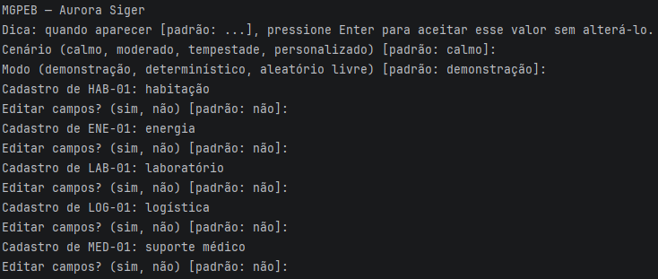

#### 2. Validação

As perguntas se repetem até receberem um valor válido. O programa aceita vírgula ou ponto nos decimais, exige percentuais entre 0 e 100, massa positiva, oscilação não negativa, prioridade inteira de 1 a 5, horário HH:MM e IDs únicos de até 10 caracteres. Valores numéricos não finitos são rejeitados.

#### 3. Classificação

As leituras são comparadas com os limiares apresentados na seção de telemetria. No modo determinístico, cada leitura é igual à média. Nos demais modos, usa-se a média somada a uma oscilação uniforme, limitada à faixa física.

#### 4. Consolidação dos resultados

No início da rodada, módulos em espera retornam à fila. A fila é ordenada por prioridade e chegada. Se o primeiro módulo for bloqueado, o próximo é avaliado. Após uma autorização, a área fica ocupada para os demais módulos daquela rodada.

Módulos em alerta só retornam à fila após confirmação do operador e têm seus sensores reavaliados. Cada movimentação é registrada na pilha de eventos.

O fluxo apresentado no documento de arquitetura resume essa movimentação:

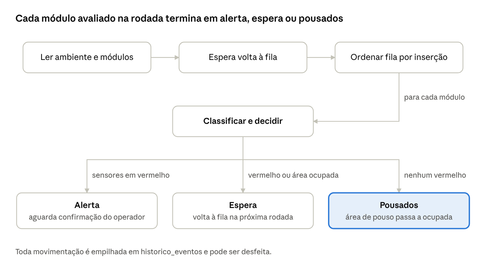

A poeira e as partículas levantadas pelos retrofoguetes motivam o tratamento da área como ocupada durante uma descida. A checagem da área e a confirmação para liberar alertas mantêm o operador no ciclo de decisão.

#### 5. Diagnóstico final

O programa apresenta uma decisão por módulo, acompanhada das classificações e dos motivos:

- **POUSO AUTORIZADO:** todas as condições em verde e área livre;
- **POUSO AUTORIZADO COM ATENÇÃO:** existe amarelo, sem bloqueios;
- **POUSO ADIADO:** combustível, vento ou poeira em vermelho, ou área ocupada;
- **ALERTA:** sensores em vermelho, independentemente das demais condições.

## Verificação

| Classificação | Condição | Ação | Referência no projeto |
| --- | --- | --- | --- |
| 🟢 VERDE | Todas as leituras em verde e área livre | Autorizar | Material de apoio, seção 3 |
| 🟡 AMARELO | Alguma leitura em amarelo, sem bloqueios | Autorizar com atenção | Material de apoio, seção 3 |
| 🔴 VERMELHO | Sensores em vermelho | Encaminhar para alerta | Material de apoio, seção 3 |
| 🔴 VERMELHO | Outro parâmetro em vermelho ou área ocupada | Adiar | Material de apoio, seção 3 |

### Teste de Validação dos Modelos

O script inclui a função `exemplos_de_execucao()` com casos reproduzíveis de ambiente calmo, moderado, tempestade, sensores em alerta e demonstração de ordenação e busca.

No modo determinístico e com os módulos padrão:

| Cenário | Vento (m/s) | Poeira (τ) | Resultado da primeira rodada com área livre |
| --- | --- | --- | --- |
| Calmo | 5 | 0,5 | ENE-01 autorizado; demais aguardam |
| Moderado | 11 | 2,0 | ENE-01 autorizado com atenção; demais aguardam |
| Tempestade | 22 | 4,5 | Todos adiados por vento e poeira |

Para testar um módulo bloqueado no topo, altere a média de combustível do ENE-01 para 20%. No cenário moderado, ele será adiado e o MED-01 poderá pousar com atenção. Corrigir a média para 40% permite nova avaliação na rodada seguinte.

Os prints enviados pela equipe registram outra condição: cenário calmo no modo demonstração, com oscilação. Nessa execução, o ENE-01 apresenta combustível de 34,60% e sensores de 94,34%, recebendo **POUSO AUTORIZADO COM ATENÇÃO** por combustível amarelo. Os módulos seguintes são adiados pela área ocupada. Esse resultado é compatível com a simulação e difere do caso determinístico da tabela, no qual o combustível permanece em 40%.

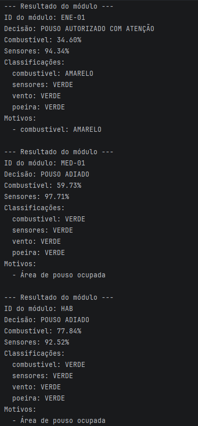

O complemento da rodada apresenta os módulos de logística e laboratório, além dos resultados matemáticos:

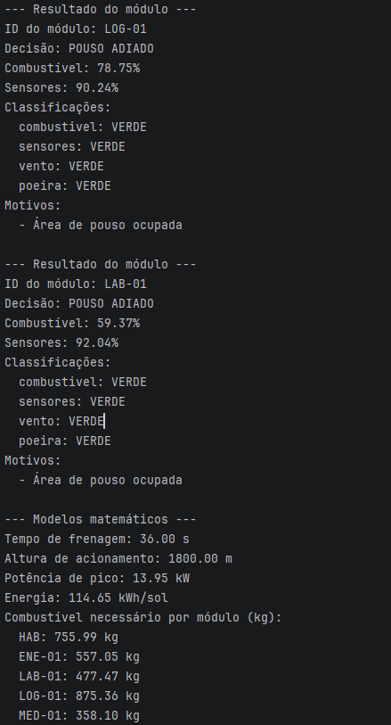

---

## Telemetria analisada

#### Combustível restante (% do tanque)

| Classificação | Intervalo | Ação | Base no projeto |
| --- | --- | --- | --- |
| 🟢 VERDE | 40 a 100 | Autorizar | Margem de aproximadamente duas vezes o combustível calculado |
| 🟡 AMARELO | 30 até menos de 40 | Autorizar com atenção | Margem entre aproximadamente 1,5 e 2 vezes o necessário |
| 🔴 VERMELHO | Abaixo de 30 | Adiar | Margem insuficiente segundo o limiar adotado |

#### Integridade dos sensores (% dos canais dentro da especificação)

| Classificação | Intervalo | Ação | Base no projeto |
| --- | --- | --- | --- |
| 🟢 VERDE | 90 a 100 | Autorizar | Leitura considerada confiável |
| 🟡 AMARELO | 75 até menos de 90 | Autorizar com atenção | Degradação parcial dos canais |
| 🔴 VERMELHO | Abaixo de 75 | Alerta | Sensores insuficientes para continuar o pouso autônomo |

#### Vento na área de pouso (m/s)

| Classificação | Intervalo | Ação | Base no projeto |
| --- | --- | --- | --- |
| 🟢 VERDE | 0 a 8 | Autorizar | Faixa típica de referência do material de apoio |
| 🟡 AMARELO | Acima de 8 até 15 | Autorizar com atenção | Vento acima da faixa nominal |
| 🔴 VERMELHO | Acima de 15 | Adiar | Limite de projeto para o pouso |

#### Poeira atmosférica (opacidade τ)

| Classificação | Intervalo | Ação | Base no projeto |
| --- | --- | --- | --- |
| 🟢 VERDE | 0 a 1 | Autorizar | Baixa opacidade |
| 🟡 AMARELO | Acima de 1 até 3 | Autorizar com atenção | Maior bloqueio da luz solar |
| 🔴 VERMELHO | Acima de 3 | Adiar | Condição de poeira acima do limite de projeto |

#### Área de pouso

| Classificação | Estado | Ação | Base no projeto |
| --- | --- | --- | --- |
| 🟢 VERDE | Livre | Permitir avaliação de autorização | Uma descida por rodada |
| 🔴 VERMELHO | Ocupada | Adiar | Evitar descidas simultâneas na área |

### Verificação da Telemetria

A autorização combina combustível, vento e poeira sem classificação vermelha, área livre e sensores sem erro. A atenção é identificada quando qualquer uma das quatro leituras está amarela. O terminal apresenta os valores, as classificações escritas e os motivos da decisão.

Os limiares são escolhas didáticas apoiadas nas missões discutidas nos documentos da equipe. Curiosity e Perseverance contextualizam a descida propulsiva e a autonomia; Viking, Pathfinder, InSight e Phoenix, as condições de vento e poeira; a tempestade de 2018, os riscos de elevada opacidade; e Surveyor 3/Apollo 12, a projeção de partículas durante um pouso. Essa relação não equivale à certificação dos limiares para uso operacional.

---

## Análise por regras e modelos matemáticos

Nesta fase, a análise é realizada por regras booleanas e modelos matemáticos implementados com a biblioteca padrão do Python.

- **Descida:** `h(t) = h0 + v0 × t + (a / 2) × t²`; calcula o tempo de frenagem e a altura de acionamento dos retrofoguetes.
- **Combustível:** `m_comb = m_f × (exp(Δv / ve) - 1)`; usa massa final em kg e inclui a perda gravitacional no Δv.
- **Energia solar:** a potência de pico considera a poeira por `exp(-τ)`; uma parábola representa a potência ao longo do período claro e fornece a energia diária.

### Teste de validação dos modelos matemáticos

Com os valores padrão, o tempo de frenagem é de 36 segundos e a altura de acionamento é de 1.800 metros. Com poeira τ = 0,5, a potência de pico é de aproximadamente 10,49 kW e a energia diária é de aproximadamente 86,2 kWh por sol. Esses resultados são referências da simulação, com as simplificações descritas no material de apoio.

O gerenciamento usa fila de pouso, listas de pousados, espera e alerta, além de uma pilha de eventos. A ordenação por inserção organiza a fila; a seleção permite comparação. As buscas sequenciais localizam menor combustível, maior prioridade e tipo de módulo; a busca binária consulta IDs em um cadastro ordenado.

| Estrutura | Papel na simulação |
| --- | --- |
| `fila_pouso` | Atendimento pelo início da fila após ordenação por prioridade e chegada |
| `pousados` | Módulos autorizados que concluíram a etapa simulada de pouso |
| `espera` | Módulos adiados que serão reavaliados na próxima rodada |
| `alerta` | Módulos que exigem confirmação do operador para retornar à fila |
| `historico_eventos` | Pilha LIFO de movimentações, decisões e motivos |

Cada evento registra rodada, ID do módulo, origem, destino, posição, decisão, motivos e estado anterior da área. Na implementação atual, desfazer devolve o módulo à fila, reordena o atendimento e libera a área de pouso.

A opção de estado permite observar os destinos após uma rodada:

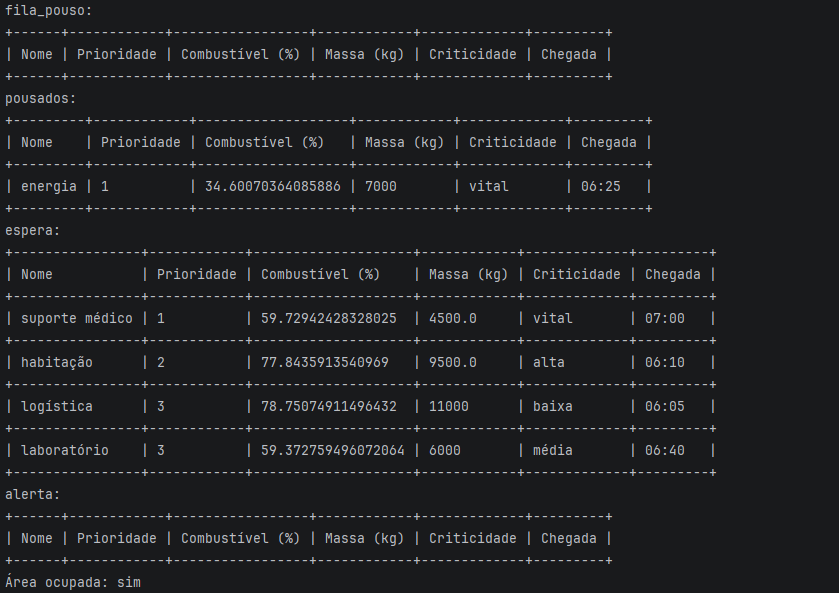

O modelo energético também mostra a influência da poeira: para τ = 3, o pico calculado cai para aproximadamente 0,86 kW. Já o print da rodada registra 13,95 kW e 114,65 kWh/sol, pois usa a poeira sorteada daquela execução, em vez do valor fixo τ = 0,5 empregado na referência acima.

---

## Tecnologias utilizadas

- Python 3;
- `random`, para simular as oscilações das leituras;
- `math`, para cálculos exponenciais e validação numérica;
- entrada e saída no terminal com `input` e `print`;
- Git e GitHub, para versionamento e colaboração.

A opção por biblioteca padrão, estruturas pequenas e algoritmos explícitos permite estudar as restrições de memória, processamento e energia descritas na contextualização arquitetural. A fila é ordenada a cada rodada na implementação atual. Validações e regras simples ajudam a verificar o protótipo; a resistência à radiação e às temperaturas de Marte é uma exigência de hardware apresentada como contexto do trabalho.

As fontes discutidas pela equipe incluem NASA Mars Fact Sheet, o estudo de Way et al. sobre a descida da MSL (2006), materiais NASA/JPL sobre Curiosity e Perseverance, o estudo de Paton, Harri e Savijärvi sobre ventos (2018), a publicação da DLR sobre energia da InSight (2022) e NASA Computers in Spaceflight. O documento histórico indica que algumas especificações de computadores e o intervalo de atraso de comunicação ainda precisam ser conferidos em fonte oficial antes da entrega acadêmica.

---

## ⚙️ Como executar

### Pré-requisitos

- Python 3 instalado;
- terminal para executar o script;
- Git, caso o repositório seja clonado.

O programa utiliza somente a biblioteca padrão. Não é necessário instalar pacotes adicionais.

### Execução

1. Clone a branch de pouso:

```bash
git clone --branch pouso https://github.com/claudioreissilveira/Tribo-Solarian.git
cd Tribo-Solarian
```

2. Execute o arquivo principal a partir da pasta do projeto:

```bash
python script/TriboSolarian_MGPEB.py
```

3. Escolha o cenário e o modo de simulação:

   - **Demonstração:** semente fixa 42, com oscilação e resultados reproduzíveis a cada execução.
   - **Determinístico:** leitura igual à média, sem oscilação.
   - **Aleatório livre:** leituras variáveis entre execuções.

4. Aceite os cinco módulos padrão ou edite seus campos:

| ID | Tipo | Massa final (t) | Prioridade | Criticidade | Chegada |
| --- | --- | --- | --- | --- | --- |
| HAB-01 | Habitação | 9,5 | 2 | Alta | 06:10 |
| ENE-01 | Energia | 7,0 | 1 | Vital | 06:25 |
| LAB-01 | Laboratório | 6,0 | 3 | Média | 06:40 |
| LOG-01 | Logística | 11,0 | 3 | Baixa | 06:05 |
| MED-01 | Suporte médico | 4,5 | 1 | Vital | 07:00 |

As médias e oscilações padrão das leituras são:

| ID | Combustível (%) | Sensores (%) |
| --- | --- | --- |
| HAB-01 | 70 ± 10 | 95 ± 3 |
| ENE-01 | 40 ± 12 | 96 ± 3 |
| LAB-01 | 65 ± 10 | 92 ± 4 |
| LOG-01 | 80 ± 8 | 94 ± 4 |
| MED-01 | 55 ± 10 | 97 ± 2 |

O combustível do ENE-01 pode variar de 28% a 52%, cruzando as três classificações. Os sensores do LAB-01 podem variar de 88% a 96%, alternando entre amarelo e verde. Esses intervalos permitem observar mudanças de decisão entre rodadas nos modos com oscilação.

5. Use o menu para operar a simulação:

| Opção | Operação |
| --- | --- |
| 1 | Executar a próxima rodada, informando a disponibilidade da área |
| 2 | Mostrar as estruturas e o último evento |
| 3 | Buscar módulo por combustível, prioridade, tipo ou ID |
| 4 | Comparar ordenações e analisar os módulos da fila |
| 5 | Editar um módulo ou trocar o cenário |
| 6 | Desfazer o último evento ou liberar um módulo em alerta |
| 7 | Sair |

O menu e a confirmação de área livre aparecem no registro de execução:

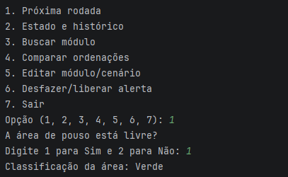

**Busca de módulo — opção 3.** O exemplo consulta o ID `HAB`, usado no cadastro daquela execução. Ao usar os padrões do projeto, informe `HAB-01`.

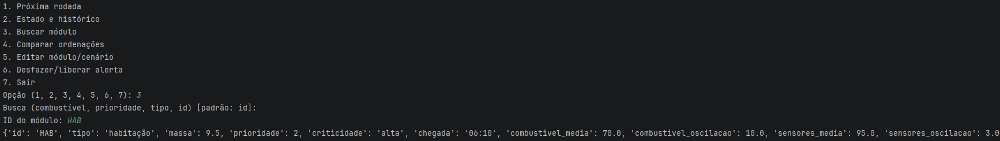

**Comparação de ordenações — opção 4.** O print apresenta listas vazias porque, após a rodada, os módulos já foram encaminhados para pousados ou espera. Para observar a ordem dos cinco módulos, execute essa opção antes da primeira rodada.

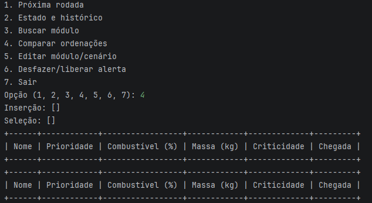

**Edição — opção 5.** O operador pode alterar os dados de um módulo ou trocar o cenário. O exemplo registra a edição do módulo de habitação, mantendo os padrões por Enter.

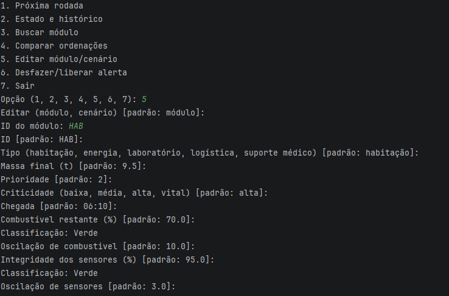

**Desfazer ou liberar alerta — opção 6.** O registro mostra o evento de adiamento do LAB-01 retirado do histórico pela ação desfazer. O print demonstra desfazer; a liberação de alerta é outra ação disponível no mesmo menu e exige confirmação.

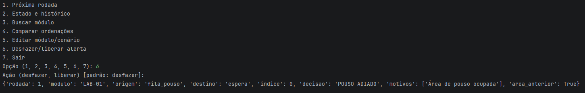

### Resultado esperado

O sistema apresenta a decisão e os motivos de cada módulo avaliado, registra suas movimentações e informa os resultados dos modelos matemáticos. No cenário calmo determinístico, com área livre a cada rodada, a ordem de pouso é:

**ENE-01 → MED-01 → HAB-01 → LOG-01 → LAB-01**

Os resultados possíveis são:

- 🟢 **POUSO AUTORIZADO**;
- 🟡 **POUSO AUTORIZADO COM ATENÇÃO**;
- 🔴 **POUSO ADIADO**;
- 🔴 **ALERTA**.

Ao selecionar a opção 7, a aplicação encerra a simulação, como no registro da equipe:

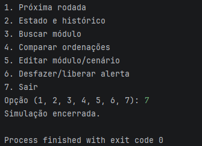

---
