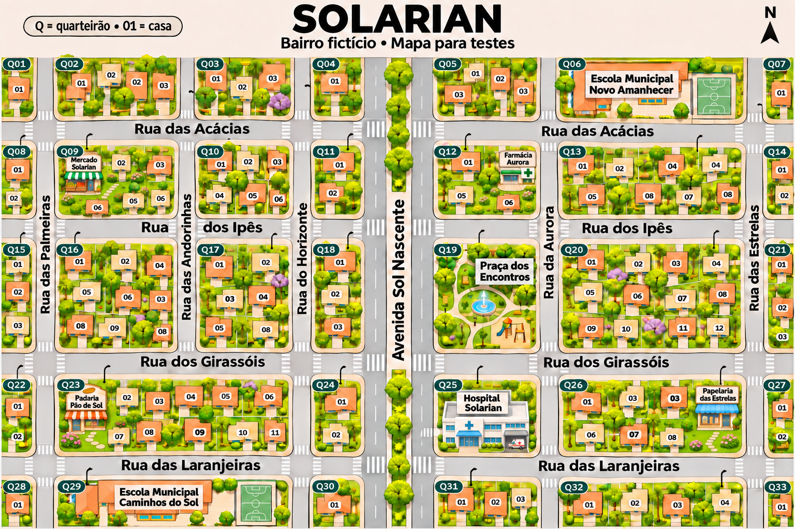

# Solarian: guia do bairro e convivência

O Bairro Solarian é uma simulação realista de um sistema de gestão comunitária, desenvolvida para o desafio Neighborhood Action Dashboard. O projeto parte de situações do cotidiano de um bairro, como a lâmpada apagada, a calçada sem acesso e o lixo acumulado, e reproduz funcionalidades presentes em serviços reais de atendimento ao cidadão: registro de ocorrências, triagem, acompanhamento de cada etapa, apoio a registros existentes, indicadores e agenda de eventos.

O objetivo é compreender a rotina dos moradores e demonstrar como a organização das informações facilita a vida em comunidade, aproximando quem relata um problema de quem administra o bairro e tornando visível o andamento de cada solicitação.

Para que a simulação se aproxime do uso real, o cenário foi construído com mapa, vias, pontos de referência, moradores e regras de convivência próprios, descritos neste documento. Nomes, horários e procedimentos são fictícios e não representam legislação nem serviços de um município real.

O mapa utiliza identificadores de quarteirão de **Q01 a Q33**. As etiquetas brancas indicam imóveis, e a numeração recomeça em cada quarteirão. Exemplo de referência: **Q20, casa 10**. A Avenida Sol Nascente divide o bairro em dois lados, Oeste e Leste.

## Ruas e avenida principal

| Tipo | Nome |
|---|---|
| Avenida | Avenida Sol Nascente |
| Rua | Rua das Acácias |
| Rua | Rua dos Ipês |
| Rua | Rua dos Girassóis |
| Rua | Rua das Laranjeiras |
| Rua | Rua das Palmeiras |
| Rua | Rua das Andorinhas |
| Rua | Rua do Horizonte |
| Rua | Rua da Aurora |
| Rua | Rua das Estrelas |

## Pontos de referência

| Local | Localização no mapa |
|---|---|
| Praça dos Encontros | Q19, junto à Avenida Sol Nascente e à Rua dos Girassóis |
| Escola Municipal Novo Amanhecer | Q06, junto à Rua das Acácias |
| Escola Municipal Caminhos do Sol | Q29, junto à Rua das Laranjeiras |
| Mercado Solarian | Q09 |
| Farmácia Aurora | Q12 |
| Padaria Pão de Sol | Q23 |
| Papelaria das Estrelas | Q26 |
| Hospital Solarian | Q25, ao lado da Avenida Sol Nascente, entre as ruas dos Girassóis e das Laranjeiras |

## Moradores fictícios

O cadastro contém **28 moradores**, todos com perfil **Morador**. Os e-mails utilizam o domínio `example.com`, reservado para exemplos. Há intervalos na sequência de identificadores porque nenhum morador é vinculado a imóveis ocupados por estabelecimentos.

| ID | Nome | E-mail | Quarteirão | Casa |
|---|---|---|---|---|
| USR001 | Ana Clara Martins | ana.martins@example.com | Q02 | 01 |
| USR002 | Bruno Henrique Costa | bruno.costa@example.com | Q03 | 02 |
| USR003 | Camila Ferreira Lima | camila.lima@example.com | Q04 | 01 |
| USR004 | Diego Rafael Santos | diego.santos@example.com | Q05 | 02 |
| USR005 | Elisa Moreira Alves | elisa.alves@example.com | Q08 | 01 |
| USR006 | Felipe Augusto Rocha | felipe.rocha@example.com | Q10 | 03 |
| USR007 | Gabriela Souza Ribeiro | gabriela.ribeiro@example.com | Q11 | 02 |
| USR008 | João Pedro Oliveira | joao.oliveira@example.com | Q18 | 03 |
| USR009 | Larissa Almeida Nunes | larissa.nunes@example.com | Q23 | 06 |
| USR010 | Marcos Vinícius Barbosa | marcos.barbosa@example.com | Q32 | 04 |
| USR011 | Beatriz Carvalho Mendes | beatriz.mendes@example.com | Q01 | 01 |
| USR012 | Carlos Eduardo Teixeira | carlos.teixeira@example.com | Q02 | 02 |
| USR013 | Daniela Cristina Lopes | daniela.lopes@example.com | Q03 | 01 |
| USR014 | Eduardo Henrique Castro | eduardo.castro@example.com | Q05 | 01 |
| USR015 | Fernanda Azevedo Pinto | fernanda.pinto@example.com | Q07 | 01 |
| USR017 | Helena Duarte Freitas | helena.freitas@example.com | Q10 | 01 |
| USR018 | Igor Matheus Correia | igor.correia@example.com | Q12 | 02 |
| USR019 | Juliana Batista Ramos | juliana.ramos@example.com | Q13 | 01 |
| USR020 | Lucas Gabriel Dias | lucas.dias@example.com | Q14 | 02 |
| USR021 | Mariana Campos Silveira | mariana.silveira@example.com | Q15 | 03 |
| USR022 | Nicolas André Monteiro | nicolas.monteiro@example.com | Q16 | 01 |
| USR023 | Patrícia Regina Moraes | patricia.moraes@example.com | Q17 | 02 |
| USR024 | Rafael Henrique Farias | rafael.farias@example.com | Q20 | 10 |
| USR025 | Renata Cristina Tavares | renata.tavares@example.com | Q21 | 02 |
| USR026 | Samuel Pereira Macedo | samuel.macedo@example.com | Q22 | 01 |
| USR027 | Tatiane Gomes Rezende | tatiane.rezende@example.com | Q24 | 02 |
| USR029 | Vanessa Cristina Melo | vanessa.melo@example.com | Q30 | 01 |
| USR030 | Vitor Hugo Fernandes | vitor.fernandes@example.com | Q31 | 02 |

## Regras de convivência e serviços

### 1. Coleta de lixo comum

- A coleta acontece às **segundas, quartas e sextas-feiras, das 7h às 10h**.
- Colocar os sacos bem fechados na frente do imóvel entre **6h e 7h**, somente no dia da coleta.
- Manter os resíduos fora da faixa livre de circulação e das rampas de acessibilidade.

### 2. Coleta seletiva

- A coleta acontece às **terças e quintas-feiras, das 8h às 11h**.
- Separar papel, plástico, metal e vidro, mantendo os materiais limpos e secos.
- Disponibilizar os recicláveis até as **8h** do dia da coleta.
- Embalar e identificar vidros quebrados para evitar acidentes.

### 3. Entulho e móveis usados

- O recolhimento acontece aos **sábados, das 8h às 12h**, mediante agendamento com a administração fictícia do bairro até **quinta-feira, às 18h**.
- Disponibilizar os materiais somente no dia confirmado, preservando a passagem de pedestres.

### 4. Descarte irregular

- É proibido descartar lixo, móveis, entulho ou óleo em terrenos, praças, bueiros e vias públicas.
- Não queimar resíduos nem despejar produtos nos ralos de rua.

### 5. Horário de silêncio

- O horário de silêncio vai das **22h às 8h**.
- Nesse período, evitar música, festas, equipamentos e outras fontes de ruído que incomodem os vizinhos.
- Nos demais horários, manter música, televisão e conversas em volume moderado.

### 6. Obras e reformas

- Atividades com ruído podem ocorrer de **segunda a sexta, das 8h às 18h**, e aos **sábados, das 9h às 13h**.
- Aos domingos e feriados, somente reparos emergenciais.
- Manter materiais dentro do imóvel e evitar poeira ou resíduos nas casas vizinhas.
- Sinalizar intervenções que afetem a circulação e preservar uma passagem acessível.

### 7. Festas e eventos

- Eventos particulares devem respeitar o horário de silêncio e manter as vias desobstruídas.
- Eventos na Praça dos Encontros precisam de agendamento e autorização da administração fictícia do bairro.
- A organização deve informar o horário de início, cuidar da limpeza e preservar jardins e equipamentos.
- Acessos ao hospital, às escolas, aos imóveis e às rampas devem permanecer livres.

### 8. Calçadas e acessibilidade

- Manter a passagem livre para pedestres, cadeiras de rodas e carrinhos de bebê.
- Não bloquear calçadas ou rampas com veículos, materiais, lixo ou mobiliário comercial.

### 9. Animais de estimação

- Conduzir os animais com guia nos espaços públicos e recolher suas fezes.
- Evitar que circulem sozinhos pelas ruas.
- Preservar a segurança de crianças, pedestres e outros animais.

### 10. Praça dos Encontros

- Preservar jardins, bancos, fonte e playground.
- Não quebrar equipamentos, retirar plantas ou deixar resíduos no local.
- Crianças devem utilizar o playground com acompanhamento de um responsável.

### 11. Trânsito próximo às escolas

- Respeitar a sinalização e as travessias de pedestres.
- Não estacionar sobre faixas, calçadas ou em frente aos portões das escolas, mesmo durante embarque e desembarque.
- Redobrar a atenção nos horários de entrada e saída.

### 12. Limpeza dos imóveis

- Manter quintais e terrenos limpos, sem acúmulo de resíduos ou água parada.
- Cuidar da vegetação para que não bloqueie a circulação ou a visibilidade.
- Não direcionar água de lavagem e resíduos para imóveis vizinhos ou espaços públicos.

### 13. Registro de ocorrências

- Informar categoria, localização e descrição objetiva do problema.
- Indicar a localização pela rua ou por um ponto de referência do bairro.
- O sistema simulado recebe solicitações urbanas; situações com risco imediato devem seguir o atendimento de emergência.

### 14. Respeito e privacidade

- Não publicar ofensas, ameaças, acusações pessoais ou dados de terceiros.
- Descrever o problema sem identificar pessoas, pacientes, estudantes ou o interior de residências.
- Utilizar exclusivamente dados fictícios.

### 15. Ocorrências duplicadas

- Antes de abrir um registro, verificar se o mesmo problema já foi informado.
- Se houver uma ocorrência correspondente, apoiar o registro existente.
- Problemas diferentes no mesmo local podem ser registrados separadamente.

### 16. Acesso ao Hospital Solarian

- Manter livres a entrada principal e o acesso de ambulâncias do Q25.
- Evitar buzinas e ruídos desnecessários nas proximidades.
- Não ocupar acessos ou vagas sinalizadas para atendimento.

### 17. Convivência com os comércios

- Comerciantes devem manter a frente do estabelecimento limpa e a calçada acessível.
- Cargas, descargas e filas devem preservar a circulação e o acesso dos vizinhos.
- Resíduos comerciais não devem ser abandonados na rua.
- Propaganda sonora deve respeitar as regras de ruído do bairro.
